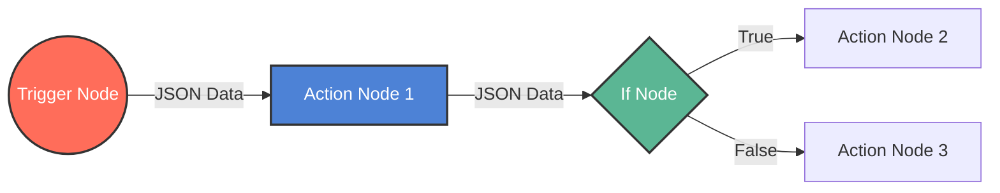
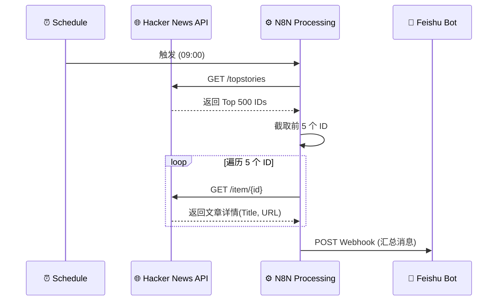

## 前言：为什么选择 N8N？

在数字化转型的浪潮中，工作流自动化（Workflow Automation）已成为提升效率的关键。市面上有 Zapier、Make (Integromat) 等优秀的 SaaS 工具，但它们往往存在数据隐私顾虑、高昂的订阅费用以及灵活性受限等问题。

**N8N (Nodemation)** 作为一款**公平代码（Fair-code）**的开源工作流自动化工具，以其独特的优势脱颖而出：

- **自托管（Self-hosted）**：你可以将其部署在自己的服务器上，完全掌控数据隐私。
- **节点丰富**：内置 1000+ 种集成，覆盖主流 SaaS 服务、数据库、AI 模型等。
- **可视化编排**：基于节点的流程图设计，逻辑清晰直观。
- **强大的扩展性**：支持 JavaScript/Python 代码节点，几乎可以实现任何逻辑。
- **AI Native**：近期版本深度集成了 LangChain，能够轻松构建 AI Agent。

本文将带你从零开始掌握 N8N，从基础概念到构建复杂的 AI 工作流。

## 1. 核心概念 (Core Concepts)

在使用 N8N 之前，理解以下核心概念至关重要。

### 1.1 工作流 (Workflow)

工作流是 N8N 的基本单元，由一系列节点（Nodes）和连接线（Connections）组成，定义了数据如何流动和处理。

### 1.2 节点 (Nodes)

节点是执行特定操作的积木。主要分为两类：

- **触发器节点 (Trigger Nodes)**：工作流的起点。例如：`Schedule`（定时触发）、`Webhook`（HTTP 请求触发）、`Telegram Trigger`（收到消息触发）。
- **常规节点 (Regular Nodes)**：执行动作或处理数据。例如：`HTTP Request`、`Google Sheets`、`Code`、`AI Agent`。

### 1.3 连接 (Connections)

连接线定义了节点的执行顺序。数据（JSON 对象）通过连接线从一个节点流向下一个节点。



### 1.4 数据结构 (Data Structure)

N8N 中所有数据都以 JSON 格式传递。每个节点接收一个对象数组，并输出一个对象数组。理解这一点对于处理列表数据非常重要。

## 2. 安装与部署

N8N 提供了多种部署方式，推荐使用 Docker 进行生产环境部署。

### 2.1 Docker Compose 部署 (推荐)

创建一个 `docker-compose.yml` 文件：

```yaml
version: "3.8"

services:
  n8n:
    image: n8nio/n8n:latest
    ports:
      - "5678:5678"
    environment:
      - N8N_BASIC_AUTH_ACTIVE=true
      - N8N_BASIC_AUTH_USER=admin
      - N8N_BASIC_AUTH_PASSWORD=your_secure_password
      - N8N_HOST=n8n.example.com
      - WEBHOOK_URL=https://n8n.example.com/
    volumes:
      - ./n8n_data:/home/node/.n8n
    restart: always
```

运行命令：

```bash
docker-compose up -d
```

访问 `http://localhost:5678` 即可开始使用。

### 2.2 本地测试 (npm)

如果你安装了 Node.js，可以直接运行：

```bash
npx n8n
```

## 3. 快速上手：构建你的第一个工作流

**场景**：每天早上 9 点，获取 Hacker News 的热门文章，并发送到飞书/钉钉群机器人。

### 步骤分解

1.  **添加 Trigger**：搜索并添加 `Schedule` 节点，设置为每天 9:00 触发。
2.  **获取数据**：添加 `HTTP Request` 节点。
    - Method: `GET`
    - URL: `https://hacker-news.firebaseio.com/v0/topstories.json` (获取 ID 列表)
3.  **数据处理**：由于上一步返回的是 ID 数组，我们需要取前 5 个。
    - 添加 `Code` 节点，JavaScript 代码：`return items[0].json.slice(0, 5).map(id => ({json: {id}}));`
4.  **获取详情**：再次添加 `HTTP Request` 节点。
    - URL: `https://hacker-news.firebaseio.com/v0/item/{{ $json.id }}.json`
5.  **发送消息**：添加 `HTTP Request` 节点（调用飞书 Webhook）。
    - Method: `POST`
    - Body: JSON
    - Content: 构造飞书消息格式。



## 4. 进阶技巧：表达式与代码节点

N8N 的强大之处在于其灵活性。

### 4.1 表达式 (Expressions)

在任何节点的输入框旁边，点击齿轮图标选择 "Expression"，你可以引用其他节点的数据。

- `{{ $json.title }}`: 获取当前项的 title 字段。
- `{{ $node["NodeName"].json.data }}`: 获取指定节点的输出数据。
- `{{ $now.format('yyyy-MM-dd') }}`: 获取当前日期。

### 4.2 Code 节点

当内置节点无法满足需求时，使用 Code 节点（支持 JavaScript 和 Python）。

**示例：数据清洗**

```javascript
// 遍历所有输入项
for (const item of items) {
  // 添加新字段
  item.json.processed_at = new Date().toISOString();
  // 简单的逻辑判断
  if (item.json.score > 100) {
    item.json.is_popular = true;
  }
}
return items;
```

## 5. 构建 AI Agent (LangChain 集成)

N8N 近期引入了高级 AI 功能，可以直接在工作流中构建 Chatbot 或 Agent。

### 核心组件

- **AI Agent 节点**：大脑，负责协调工具和对话历史。
- **Model 节点**：连接 LLM (OpenAI, Anthropic, Ollama 等)。
- **Memory 节点**：管理上下文 (Window Buffer Memory 等)。
- **Tool 节点**：赋予 AI 能力 (Calculator, Wikipedia, Custom Tools)。

### 架构图

```mermaid
graph TD
    User[用户输入] --> Webhook
    Webhook --> Agent[AI Agent Node]

    subgraph AI Configuration
        LLM[Chat Model (e.g., GPT-4)]
        Memory[Window Buffer Memory]
        Tools[Tools (Calculator, Search)]
    end

    LLM --> Agent
    Memory --> Agent
    Tools --> Agent

    Agent -->|思考与调用| Tools
    Tools -->|返回结果| Agent
    Agent -->|最终回复| WebhookResponse
```

**实战思路**：
你可以创建一个“智能客服 Agent”，连接你的知识库（Vector Store），当用户提问时，Agent 先检索知识库，如果找不到答案，再调用 Google Search 工具，最后整理回答返回给用户。

## 6. 最佳实践

1.  **凭证管理 (Credentials)**：永远不要在节点参数中硬编码 API Key。使用 N8N 的 Credentials 功能统一管理，确保安全。
2.  **错误处理 (Error Handling)**：
    - 在关键节点设置 "Continue On Fail"。
    - 创建一个专门的 Error Workflow，并在主 Workflow 的 Settings 中配置 "Error Workflow"。当流程失败时，自动发送报警通知。
3.  **版本控制**：虽然 N8N 是可视化的，但你可以通过 Git 备份 `.n8n` 目录，或者使用社区提供的 Git 备份工作流。
4.  **拆分工作流**：不要把所有逻辑塞在一个巨大的工作流里。使用 `Execute Workflow` 节点调用子工作流，保持逻辑清晰。

## 结语

N8N 填补了简单自动化工具与纯代码开发之间的空白。它既能让非技术人员快速搭建原型，又能让开发者通过代码扩展无限可能。在 AI 时代，N8N 更是连接 LLM 与真实业务系统的绝佳桥梁。

开始你的自动化之旅吧！
